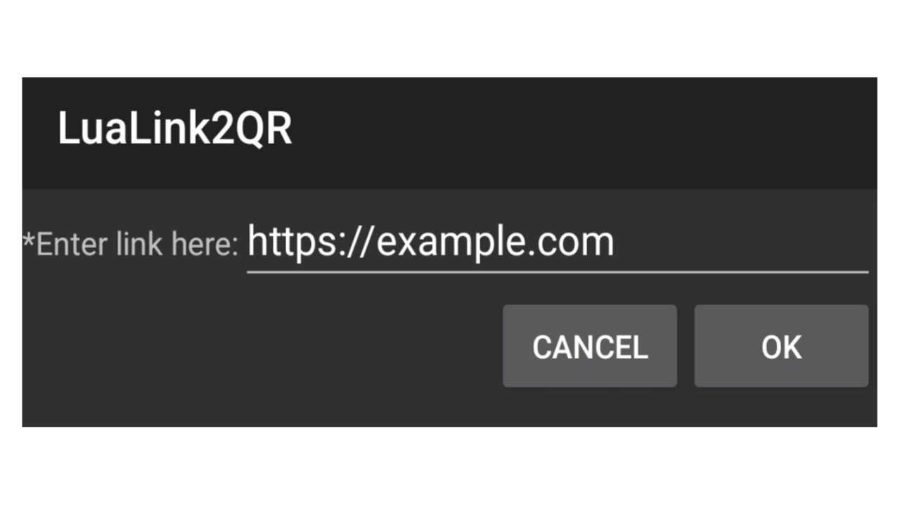

	

# 💻 Lua Link2QR

> A simple URL to QR-code converter written in Lua using the ExecLua environment. It allows users to enter a URL and generate its corresponding QR code with just a few steps.

---

## 📌 Overview

	

---

Features

- ✅ Customizable Link
- ✅ QR Code Generation
- ✅ Simple Interface
- ✅ Lightweight

---

## 🎯 Why This Repo?

these programs:

- Generate a QR code directly from your input.
- Comes with https://example.com as a sample URL.
- Uses an interactive form powered by ExecLua.
- Minimal code with no complicated setup.

---

## 📌 Notes

- Ensure that the URL is valid before generating the QR code.

- The QR code contains the supplied link; scanning it does not guarantee that the destination is safe.

- QR code generation depends on the functionality provided by ExecLua.

---

## ⚠️ Notice

LuaLink2QR only works by using ExecLua application.
[(Click here to download ExecLua)](https://play.google.com/store/apps/details?id=de.mlauer.luatest)

---

## 📥 Download
[Click here to download LuaLink2QR](https://github.com/xHak1m/LuaLink2QR/blob/main/main.lua)

---

## 📬 Contact

Feel free to connect or suggest improvements: https://github.com/xHak1m
